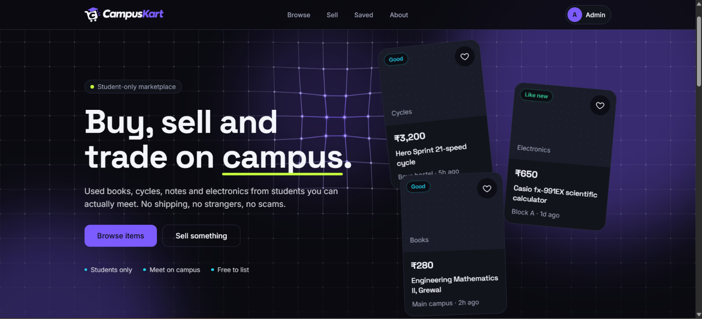
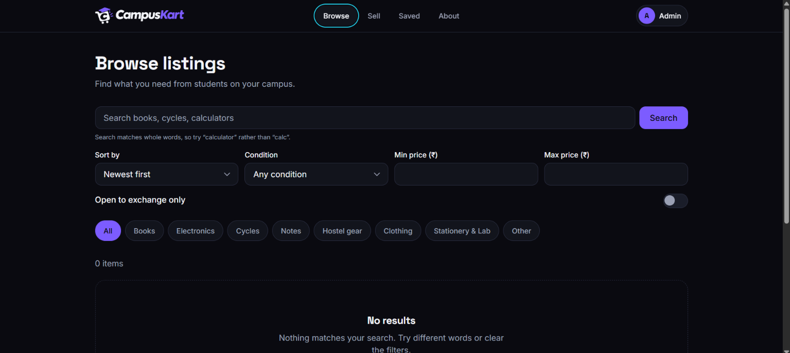
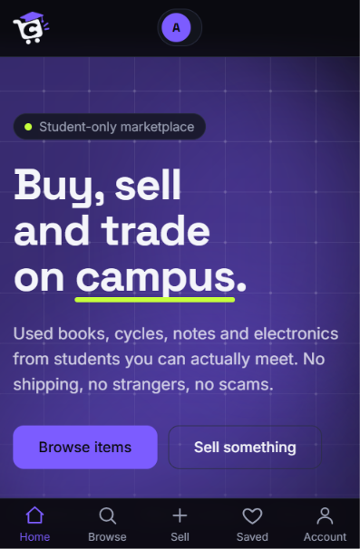
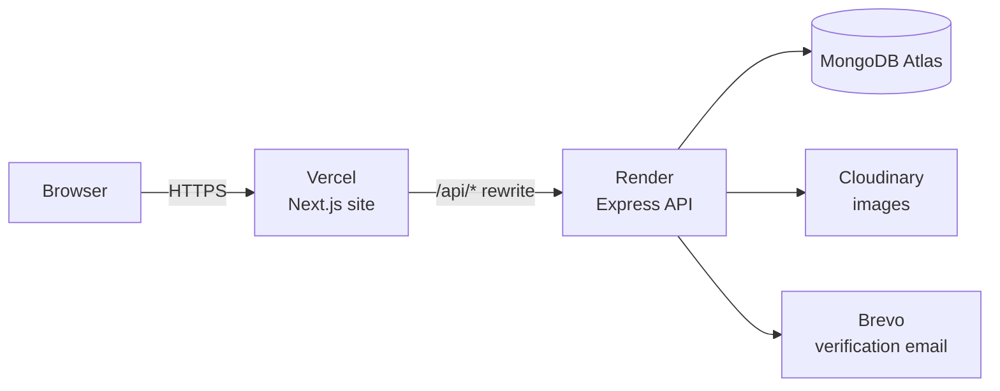

<div align="center">

# 🛒 CampusKart

### Buy, sell and swap on campus — safely, with people you actually share a campus with.

A student-only marketplace: verify with your college email, list a used book or cycle in a minute, and message the seller. No strangers. No fees. Built solo, deployed live, **$0 spent**.

**[🚀 Live demo → campuskart-vert.vercel.app](https://campuskart-vert.vercel.app)**


</div>



---

## ✨ Why CampusKart?

Students buy and sell the same things every semester — textbooks, calculators, cycles, hostel furniture — but it all happens in messy WhatsApp groups where nothing is searchable and anyone can join. CampusKart gives that a proper home:

- **Trusted by design** — only verified college emails can post, message or report
- **Fast to use** — browse by category, search, save items, post in under a minute
- **Safe by default** — a seller's WhatsApp number is revealed only after a buyer sends an inquiry, and only if the seller opted in

## 🎯 Features

| | |
|---|---|
| 🔐 **College-email verification** | Sign up, verify by email, log in with a secure cookie session |
| 🔎 **Browse and search** | Filter by category, condition and keyword |
| 📸 **Sell in a minute** | Photo upload (Cloudinary), edit, mark as sold |
| ❤️ **Wishlist** | Saved items synced to your account, with instant optimistic UI |
| 💬 **Inquiries** | One-way messages to sellers with an inbox; WhatsApp opt-in |
| 🚩 **Reports and admin tools** | Report a listing; admins review reports and remove listings |
| ℹ️ **About page** | What CampusKart is and who it's for |
| 🎨 **Polished UI** | Responsive "Night Market" dark theme, smooth motion that respects reduced-motion, share previews |
| ♿ **Accessible and fast** | Lighthouse 100 |

## 📱 Screenshots

| Home | Listing | Mobile |
|---|---|---|
|  |  |  |

## 🧱 Tech stack

| Layer | Tools |
|---|---|
| **Frontend** | Next.js 16 (App Router), React 19, Tailwind 4 |
| **Backend** | Node.js, Express 5, Mongoose 9, zod 4 |
| **Database** | MongoDB Atlas (free tier) |
| **Images** | Cloudinary |
| **Email** | Brevo transactional API |
| **Testing** | Vitest + Supertest — 75 tests |
| **Hosting** | Vercel (site) · Render (API) — all free tiers |

## 🏗️ How it works



The browser talks **only** to the Vercel site. Next.js proxies `/api/*` to the API, so the login cookie stays same-origin — no third-party-cookie problems.

## 🔒 Security

Security was a phase of its own, not an afterthought:

- Passwords hashed with bcrypt; sessions in an **HttpOnly, Secure, SameSite=Lax** cookie (JWT, HS256 pinned)
- Email-verification tokens stored **hashed**, and never logged in production
- Every request body validated with zod — which also blocks NoSQL operator injection
- Rate limits on login/sign-up and inquiries; helmet and extra security headers
- Admin role **re-checked from the database** on every request
- Least-privilege database user; secrets only in environment variables
- Automated tests for protected routes, injection attempts and mass-assignment
- Dependency audit clean at release

> This is a student project: real checks, not a professional audit.

## 🧪 Run it locally

You need Node 20+, pnpm, a MongoDB Atlas database and a Cloudinary account.

```bash
# clone this repository, then:
cd campuskart

# 1. API
cd server
pnpm install
cp .env.example .env        # fill in the values
pnpm dev

# 2. Site (new terminal, from the project root)
cd client
pnpm install
pnpm dev
```

**Server `.env`:** `MONGODB_URI`, `MONGODB_URI_TEST`, `JWT_SECRET`, `CLIENT_ORIGIN`, `ALLOWED_EMAIL_DOMAINS`, Cloudinary keys, and optionally `EMAIL_API_KEY` / `EMAIL_FROM`. With no email key, verification links print in your local terminal only.
**Client env:** `API_ORIGIN` (the API URL), `SITE_URL`.

```bash
pnpm test            # in server/ — runs on a separate test database
pnpm admin:create    # in server/ — creates an admin from ADMIN_EMAIL / ADMIN_PASSWORD
```

## 📚 What I learned building this

- Taking a product from idea to a **live, verified deployment**, one phase at a time
- Designing a **cookie-based auth flow** that works across Vercel and Render
- Writing an API with consistent errors and **input validation as the first line of defence**
- **Testing for security**, not just features
- Making honest trade-offs on a $0 budget, and writing them down

## ⚠️ Known limitations

An honest list — details in [`docs/KNOWN_ISSUES.md`](docs/KNOWN_ISSUES.md):

- The free API server **sleeps after 15 minutes idle**, so the first request can take up to ~50 seconds
- Verification emails are sent from a personal address, so they **may land in spam**
- No password reset, account lockout or 2FA yet
- Sessions last 7 days and can't be revoked early
- No Content-Security-Policy yet · search matches whole words only
- The free API server can sleep when idle; a free UptimeRobot ping every 5 minutes keeps it awake, but a cold start can still take up to ~50 seconds
## 🗺️ Roadmap

- [ ] Custom domain with authenticated email
- [ ] Password reset by email
- [ ] Per-account login limits and a Content-Security-Policy

## 📖 Project docs

- [`docs/PROJECT_CONTEXT.md`](docs/PROJECT_CONTEXT.md) — what was built, phase by phase
- [`docs/DECISIONS.md`](docs/DECISIONS.md) — why things were built this way
- [`docs/KNOWN_ISSUES.md`](docs/KNOWN_ISSUES.md) — what isn't done yet

## 👩‍💻 Author

**Mohona Chakraborty** — B.Tech CSE (AI-ML), Sister Nivedita University, Kolkata

If you like the project, a ⭐ on the repo means a lot.